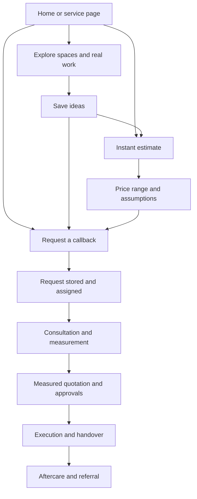
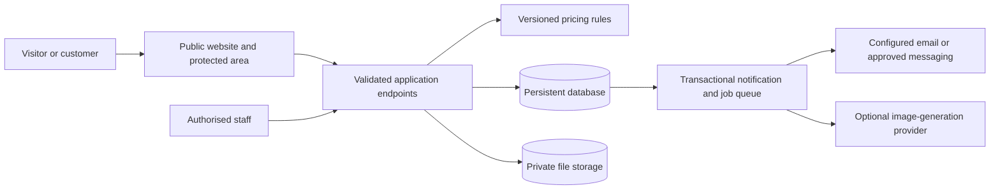

# LuxeInfra master website blueprint — version 2

**19 October 2026 · Product, design, operations and implementation specification**

Status: proposed build specification. This document does not mean the proposed features are implemented or live. It supersedes the 11 October blueprint's mandatory long-planner journey. Preserve the earlier document and version 11 release for reference and rollback.

Read with:
- `LuxeInfra-Competitor-and-Market-Report-2026-10-18.md`: evidence and competitor analysis.
- `LuxeInfra-Feature-Backlog-v2.md`: work packages, dependencies and completion checks.
- `LuxeInfra-Owner-Decisions-v2.md`: business inputs needed before activation.

## 1. Product decision

Build an interiors studio website that combines visual appeal, practical decision tools and accountable service. Visitors should quickly understand the design direction, likely budget and next step. More involved tools should appear when useful, not as a condition of contacting the studio.

**Public brand direction:** A home that feels like you.

**Proposed service position:** Considered interiors. Clear costs. A team you can reach.

This position must be supported by quotation quality, response ownership and delivery processes. A slogan does not establish a service guarantee.

**Two primary routes:**
1. **Get an instant estimate** — indicative price range from approved rules; no account or phone number required to see the range.
2. **Request a callback** — a short enquiry sent into a reliable team workflow.

**Supporting routes:** explore spaces, see actual work, compare materials, save inspiration and prepare a room concept. The detailed planner remains optional for a later design conversation.

### Confirmed business information

| Item | Confirmed value |
|---|---|
| Brand/domain | LuxeInfra / luxeinfra.in |
| Main phone and WhatsApp | +91 9026271638 |
| Additional phone, shown below main | +91 7678432743 |
| Main email | sales@luxeinfra.in |
| Additional email | infoluxeinfra@gmail.com |
| Broad service areas | Uttar Pradesh, Delhi NCR, Bengaluru |

Exact serviceable cities/pincodes, hours, legal details, commercial terms, material rates and image permissions still require owner input. The second phone is a call contact; do not assume it is also an approved WhatsApp destination.

## 2. What this takes from the competitors

Use the research for functional lessons, not copied images, copy, layouts or commercial promises.

| Competitor lesson | LuxeInfra implementation | Activation requirement |
|---|---|---|
| Multiple project entry points | Full home, selected rooms, kitchen/storage and renovation routes | Actual service catalogue |
| Price discovery | Fast estimator with editable assumptions | Approved and tested rate card |
| Guided consultation | Four-field callback, optional appointment preference | Lead storage, assigned handler |
| Specification tiers | Essential, Signature and Bespoke working names | Real differences in materials/scope |
| Room/BHK inspiration | Curated room collection and practical-need filters | Permissioned assets and useful tags |
| Real homes and video tours | Case studies with scope and material details | Verified work and client permission |
| Material education | Comparisons, care notes and glossary | Verified supplier information |
| Physical reassurance | Samples, consultation/site visit where available | Real logistics; no invented studio |
| Local acquisition | Genuine location/service pages | Delivery capacity in that location |
| Referral distribution | Customer referrals and channel-partner process | Approved programme economics/terms |
| Finance route | EMI information only if a provider is contracted | Actual provider, eligibility and terms |
| Post-sale reassurance | Care contact, snag process and later project area | Staff ownership and access controls |
| Visualisation | AI concept exploration plus designer review | Separate cost/privacy/security gates |
| Vastu/functional advice | Optional preference in consultation; later expert content | Qualified contributor; no automated certainty claims |
| Franchise growth | Reserve as a future business programme | A proven repeatable delivery model |

Competitor observations and sources are in the companion report. This is a product plan, not a statement that every competitor feature is unique, effective or suitable for day one.

## 3. Success criteria and non-negotiable rules

Success means qualified enquiries, useful price guidance, attended consultations and profitable completed projects—not only page views or form submissions.

Rules:
- Show the estimate before asking for contact information.
- Keep the callback journey short; do not turn it into a disguised design questionnaire.
- No compulsory account, floor plan, PDF download or full street address for first contact.
- Ask room-specific questions; never show kitchen work inside a bedroom.
- Reuse selections when a visitor moves between inspiration, estimate, callback and the optional planner.
- Confirm a callback request only after it has been durably received.
- Distinguish a stored request, notification delivery and a confirmed appointment.
- Never publish example reviews as real, unsupported project counts or unapproved prices/guarantees.
- Concepts, renders, inspiration and completed LuxeInfra work must be distinguishable.
- Every public feature must have an owner, maintained data and a useful failure state.

## 4. Audience and journey design

| Visitor | Immediate need | Starting route | Useful next step |
|---|---|---|---|
| New-home buyer | Understand a whole-home budget | Instant estimate | Designer discussion |
| Kitchen/storage buyer | Price and functional options | Relevant modular estimator | Measurement/consultation |
| Renovation customer | Establish feasibility and disruption | Renovation route | Short callback; optional photos later |
| Inspiration browser | Find a style and save examples | Spaces / style discovery | Estimate selected scope |
| Customer ready to talk | Reach a real person | Callback / call / WhatsApp | Assigned enquiry |
| Remote/NRI customer | Trust and visibility | Real work / virtual consultation | Later private project updates |
| Existing client | Progress or service help | Project / care route | Authorised team response |
| Referral partner | Introduce a suitable customer | Partner route | Consent-based referral tracking |

## 5. Information architecture

### Public navigation

Desktop: **Spaces · Our work · Materials · Our process · The studio**. One prominent **Get an estimate** button. Callback and phone remain easy to find through a smaller **Talk to us** control. Put journals, care, locations and partner information in a useful menu/footer instead of crowding the header.

Mobile: compact brand, menu and one primary action. A restrained bottom action area may offer Estimate / Callback, but must not cover content, consent controls or device safe areas. Avoid competing floating chat, WhatsApp, call and AI buttons.

### Proposed routes

| Area | Routes / purpose |
|---|---|
| Discovery | `/`, `/design-ideas`, `/design-ideas/:room`, `/find-your-style`, `/my-inspiration` |
| Conversion | `/estimate`, `/callback`, `/contact` |
| Detailed planning | `/plan` becomes a choice gateway; existing detailed form moves to `/project-brief` |
| Evidence | `/projects`, `/projects/:slug`, `/testimonials` when approved content exists |
| Decision support | `/materials`, `/materials/:slug`, `/how-it-works`, `/guides`, `/guides/:slug` |
| Studio/local | `/about`, `/services`, `/locations`, `/locations/:city` |
| Visualisation | `/reimagine` retains the room studio, controlled by capability flags |
| Care | `/care`, `/warranty`, `/privacy`, `/terms`, `/cancellation` as business terms become available |
| Growth | `/refer`, `/partners`; finance/franchise pages only after their business gates |
| Private customer | `/my-project` and authorised project pages in a later release |
| Staff | Protected lead/content/rate/operations area, separate from public navigation |

Route migration must preserve legitimate old links, saved inspiration and supported room/style query inputs. Do not put customer contact details in URLs. Redirect `/plan` search context into the relevant short journey rather than losing it.

## 6. Visual system and CTA redesign

Retain existing brand tokens: ivory `#f8f7f3`, deep blue `#173d71`, ink `#202b34`, secondary surface `#eeeee7`, blue tint `#e7edf3`, border `#dfdfd7`. Gold `#bba278` is a restrained decorative accent; do not assume it passes text contrast requirements. Existing headline/body pairing is Cormorant Garamond and Jost, with system fallbacks.

### Composition

- One strong image and headline in the opening screen; no rotating hero carousel.
- Alternate editorial photographs, practical comparison panels, compact stories and useful tools.
- Each section has a distinct job. A denser page should add information, not decorative filler.
- Prefer approved actual homes. Where a reference image is needed, label its role.
- Use room detail crops, material textures and floor-plan explanations to add depth.
- Body text normally 16–18 px; short line lengths; avoid tiny luxury-style captions for essential information.
- Suggested spacing scale: 8, 12, 16, 24, 32, 48, 64 and 96 px, adapted for mobile.
- Reserve image dimensions to prevent layout shifts; use responsive crops and modern delivery formats during implementation.

### Replace repetitive arrows

Primary CTA: solid deep-blue button, clear verb, generous padding and a restrained elevation/border response. Optional small **leading calculator icon**, not a repeated trailing arrow. Secondary callback action: outlined or tinted control with a small phone symbol if it aids recognition.

Examples:
- **Get my estimate**
- **Request a callback**
- **Compare these finishes**
- **See this home**
- **Save this idea**

Use colour, placement and useful wording to attract attention. Hover/focus responses should be short and subtle; no continuous pulsing or bouncing. Do not rely on motion or icons alone. A completion-time badge may be added only after user testing supports it; use “A few quick choices” initially instead of an invented 60-second claim.

Design validation widths: 360, 390, 768, 1024 and 1440 px. Suggested tappable control size is at least 44×44 CSS px where feasible. Check keyboard focus, contrast, zoom and reduced motion; do not claim accessibility certification from a visual inspection.

## 7. Homepage blueprint

| Order | Section | Proposed content | Main action |
|---|---|---|---|
| 1 | Hero | “A home that feels like you.” Image-led introduction and short scope line | Get an instant estimate; secondary callback |
| 2 | Choose your starting point | Whole home / kitchen & storage / selected rooms / renovation | Prefill the relevant journey |
| 3 | Evidence of real work | Three approved homes with location, scope and selected decisions | See this home |
| 4 | The inspiration edit | Curated room cards and practical needs | Explore spaces |
| 5 | What changes the price? | Simple material/scope explanation | Compare materials |
| 6 | The LuxeInfra way | Scope clarity, named responsibility, visible progress—only as supported | See our process |
| 7 | Room studio | Photo-to-concept explanation with honest capability state | Explore my room |
| 8 | Real experience | Approved testimonial tied to a project | Read the story |
| 9 | Local service | Actual cities/coverage and contact options | Check my location |
| 10 | Useful questions | Cost, scope, small projects, timelines and aftercare | Contextual callback |
| 11 | Closing invitation | “Let’s make room for your ideas.” | Estimate / Callback |

If real projects or reviews are unavailable, omit those sections or replace them with original material/process education. Do not fill them with fabricated proof. The footer contains both confirmed phone numbers, both emails, real service areas and working policy/contact links.

## 8. Instant estimate: customer experience

**Purpose:** a useful budget conversation, not a binding quotation or an automated construction survey.

Keep a maximum of four short panels before the result. Show one relevant group at a time, allow back/edit, and preserve selections. Do not make a user select every finish on every room before receiving value.

| Panel | Required choices | Optional refinement |
|---|---|---|
| 1. Your space | Service city/cluster; new home or renovation | Pincode; “location needs confirmation” path |
| 2. What needs doing? | Whole home / selected rooms / kitchen / wardrobes; room count or configuration where needed | Exclude rooms/items from approved default bundles |
| 3. Your direction | Specification tier; relevant size/count bands or “not sure” | Exact dimensions, board/finish alternatives, selected upgrades |
| 4. Result | No contact gate | Edit assumptions, compare tier, save/share, discuss estimate |

Whole-home estimates can use clearly displayed owner-approved module presets. A BHK selection is a way to propose quantities, not a claim that all homes of that configuration have identical work. Let users change the proposed scope.

### Ask according to scope

- Kitchen: layout or size band, base/wall cabinet assumptions, counter and accessory scope.
- Wardrobes: count, size band or optional width/height, door type and finish.
- Bedroom: wardrobes, TV/storage, study, finishes and furniture only where offered; no modular-kitchen choice.
- Living/dining: TV/display/storage, finishes, seating/dining scope where offered.
- Bathroom: scope, size band and whether plumbing/waterproofing/civil work needs review.
- Home office: workstation/storage, lighting and electrical needs.
- Pooja: mandir/storage and relevant finishes.
- Renovation: flag uncertain site conditions; never hide demolition, plumbing or protection requirements in a misleading all-in total.

The relevant-service catalogue is shared between the UI and validation/pricing layer. Changing a room removes incompatible selections and explains the adjustment. Old browser drafts are migrated safely.

### Result screen

Show a rounded lower–upper range in rupees with a short description of the selected scope. Display major components, what is included, what is excluded, assumptions for unknown dimensions, tax handling, rate validity and “Indicative estimate; final quotation follows measurement and specification approval.”

Use “Estimate uses assumed dimensions” or similar plain language, not an unsupported accuracy percentage. The result must distinguish an incomplete scoped range from a complete selected-work range.

One primary next action: **Discuss this estimate**. Prefill the short callback with estimate context; ask for name/phone/city only once. Optional actions: adjust choices, compare specifications, download a short summary or share it. Downloading must never be required.

If rates are missing, expired or outside coverage, explain that a designer review is required and offer the short callback. Do not publish a fake range, zero price or an “instant” promise that leads only to a phone-number gate.

## 9. Pricing engine specification

### Authoritative inputs

Versioned rate set with approver, activation/expiry, service region, currency and tax policy. Each item needs a stable ID, description, unit basis, quantity rules, material/finish/hardware specification, installation scope, allowances and exclusions.

Examples of different units: cabinet face area, running length, room/floor area, count and fixed scope. Explicitly distinguish carpet area from product area. Convert dimension units before calculation and validate plausible bounds; do not silently use feet where metres were supplied.

### Calculation model

For each approved scenario:

`scope subtotal = sum(quantity × applicable item rate) + approved fixed/service charges`

Then apply only the approved location, site-condition, minimum-job, discount and tax rules in their documented order. Derive lower and upper scenarios from approved assumptions/quantity ranges; do not invent a standard percentage uplift to simulate uncertainty. Round displayed results consistently while retaining auditable calculation precision.

The owner determines which services are included in rates and which adjustments are valid. A developer must not infer tax treatment, margins or supplier prices.

### Required controls

- Exclusion/dependency rules prevent invalid combinations and unsupported scope.
- Bundles expand into item IDs so separately chosen work is not charged twice.
- Included accessories/counters/installation cannot be silently billed again as extras.
- Client and server use the same versioned calculation contract. Treat browser calculations as provisional; verify on the server before persisting/sharing an official estimate reference.
- Preserve a snapshot of selected scope, rules, assumptions and rate version with an estimate. Later edits create a new version rather than changing the old result.
- Rate changes require approval and audit history; support rollback to a known approved set.
- A changed or expired rate set produces an explicit refresh/review state.
- Private cost/margin data stays on the server; public results expose only approved selling-price information.
- A rule to reject/defer a scope is preferable to a confident unsupported number.

### Validation before activation

Use owner-approved reference quotations spanning rooms, tiers, locations, unknown sizes, bundles and renovations. Agree a usable variance tolerance for each scope with the estimator's limitations visible. Any scope outside tolerance remains designer-reviewed. Test dimensional conversions, boundary values, missing rates, duplicate scope and rate-version changes.

## 10. Callback and appointment journey

Required fields: **name, mobile number, city, broad requirement**. Optional: preferred callback window, email and short note. Carry estimate/inspiration context in the background without asking again. Consent to handle an enquiry is separate from optional marketing permission.

The button says **Request a callback**. The success screen says **We’ve received your request**, gives a reference and the agreed next step. A preferred slot is not a booked appointment unless staff/calendar availability actually confirms it.

### Reliable delivery sequence

1. Validate the request on the server, apply abuse controls and accept a client retry/idempotency key.
2. Save the lead and a notification task in one durable transaction.
3. Assign the lead to a responsible person or a monitored unassigned queue.
4. Return a receipt only after storage succeeds.
5. A background worker notifies the team through the configured email or approved messaging integration.
6. Track retries, bounces, delivery failures and overdue ownership separately. Duplicate retries do not create extra leads.

Proposed team email routing: sales@luxeinfra.in with infoluxeinfra@gmail.com as the approved secondary recipient. Verify both inboxes and the sender configuration before activation. Store the complete enquiry centrally so loss of an email does not lose the lead.

If storage fails, retain the form in the current tab, show a retry and offer direct call/WhatsApp. Do not show a success tick. If notification fails after storage, retain the received status and alert staff; do not claim an email was delivered.

Direct WhatsApp is a useful parallel route. Opening it is tracked as a click, not a received lead or a sent message. Automated WhatsApp follow-up requires an actual business integration and applicable permissions; a `wa.me` link is not that integration.

## 11. Inspiration, style discovery and detailed planning

### Spaces

Curated room and service collections with visual filters: room, style, practical need and supported scope. Add price-band filtering only after each displayed range has a defined purchasable scope. No meaningless price attached to an entire picture.

Each design page identifies whether it is inspiration, a render or a real project. It supports **Save idea**, **Estimate a similar scope** and a single relevant contact action. The selected design ID travels into the estimate/callback.

### My inspiration

No-account saving remains available. Show saved images, useful tags, remove/clear controls and estimate/callback actions. Local saves remain device-specific unless the user intentionally creates a shared board/account. Warn clearly before a board containing user uploads becomes accessible to others. Private photos never become public share links by default.

### Style discovery

A few visual choices produce a suggested direction with an editable shortlist. This is taste guidance, not a diagnostic score. End at inspiration or a relevant estimate; do not require a phone number to see the direction.

### Optional detailed brief

Move the current long planner into an advanced project-brief route. It can collect floor plans, room priorities, lifestyle requirements, dimensions, timing and detailed scope when the customer chooses. Keep relevant options and allow the designer to help. It is no longer the default homepage conversion.

## 12. Projects, testimonials and proof

Project schema: ID/slug, service location at an approved level of detail, property type, scope, brief, design decisions, approved before/after media, materials, delivered items, completion date, price context and testimonial permission.

If costs are published, state whether they are historical, tax-inclusive and limited to a particular scope. Do not imply the same price applies to a different home today. Distinguish design time from execution time in any duration.

Project cards should answer: What was the problem? What did LuxeInfra do? What can I compare with my own home?

Reviews require genuine attribution, permission and source where available. Do not publish an aggregate star score, third-party logo or “verified” badge without evidence and permission. Keep sample reviews internal; approved reviews can later power both homepage and testimonial page.

Media workflow: permission/source record → editorial draft → factual review → publish → periodic review. Customer addresses and private plans are not public case-study content by default.

## 13. Materials, packages and functional advice

Materials library: core boards, shutters/finishes, hardware, counters, lighting and relevant trade finishes. Each entry has appearance, typical use, care, limitations, verified specification and pricing implications tied to our actual offering.

Comparisons should explain where a material is suitable. Avoid “MDF is always bad” or “plywood is always waterproof.” Manufacturer documents and the final specification govern.

Tier names are provisional: **Essential · Signature · Bespoke**. Each must list actual differences and shared inclusions. Bespoke can require review; do not invent a finite automated price for unlimited customisation.

Useful additional content: storage planning, easy-clean kitchens, access/maintenance, lighting layers, renovation protection, family needs and optional Vastu preferences. Functional claims require examples or expert review; do not promise a percentage increase in space without a defensible measurement method.

## 14. Room studio and public AI

The existing room studio is a useful local prototype. Public AI activation is a separate release; the current public server deliberately disables generation.

Journey: select a photo → room type → approximate dimensions → desired change/retained items → style → review provider/cost implications and consent → generate → compare → save or discuss with designer.

Keep an original-photo view and label the generated result as a concept. Do not promise exact geometry, structural safety, accurate quantities or a measured quotation from an image. Convert dimensions correctly and tell users that a designer must verify fit and feasibility.

### Public service requirements

- Keys only on the server, separate test/production configuration.
- Validate/re-encode images, strip metadata, cap file size/dimensions and use private temporary storage.
- Per-session/account controls, rate limits and abuse detection before the paid provider call.
- Persisted global quota and concurrency-safe reservation; process-local counters cannot protect a multi-instance public deployment.
- Owner-approved cost cap/maximum attempts plus alerts and a kill switch. Provider dashboard budgets alone must not be assumed to enforce an immediate hard stop.
- Job IDs, state and ownership validation. Track pending/generating/completed/failed/expired states.
- Prevent duplicate provider submissions; if a response is uncertain, reconcile the existing job before allowing another attempt. Do not assume a provider supports idempotency unless verified.
- Defined photo/result retention and deletion, with provider retention disclosed accurately.
- Fail gracefully into designer consultation when the service is unavailable or quota is exhausted.
- Explicit opt-in before the customer's photo is sent for generation. Selecting a photo alone does not initiate transmission.

A full interactive 3D room planner or automatic floor-plan measurement engine is a separate future product. The blueprint includes it as an evaluation item, not a promised capability of the photo feature.

## 15. Lead management and staff operations

A simple protected lead desk comes before a large customer portal.

Lead fields: reference, created time, contact, service location, scope, originating route/campaign, optional estimate snapshot, inspiration IDs, consent status/version, owner, next task, stage, preferred contact window and outcome reason.

Stages: received → assigned → contacted → qualified → consultation scheduled → attended → site visit → quotation shared → won/lost/on hold. Record stage history, not just the latest label. Reopened enquiries can be linked without silently overwriting prior consent/context.

Daily work view: unassigned, due today, overdue, failed notifications and appointments. Every active lead has a next action or an explicit on-hold reason. A staffed response target is an internal operational decision before it becomes a public promise.

Provide source/outcome reporting and controlled exports. Restrict staff to their role and applicable projects; log sensitive administrative actions. Keep operations usable for a small team rather than introducing a large CRM solely for its feature count.

## 16. Quotation, execution and customer project area

### Measured quotation

Versioned room/item scope, quantities and units, brand/specification, rate, tax treatment, exclusions, allowances, payment milestones, validity, design approval, timeline start conditions and service terms. Customer approval of a change produces a recorded scope/cost/time update.

### Project area — later release

Invite customers after a project is genuinely created. Secure access to their own project, with:
- Named contact, current stage and next milestone.
- Approved designs and quotation versions.
- Weekly progress photographs, date and next steps.
- Change requests with approval status.
- Payment schedule/status drawn from actual records; no unsupported “paid” label.
- Handover/snags, warranty documents and care requests.

The first portal can be mostly read-only. Add approval/payment functionality only after audit, reconciliation and ownership are established. Never store card details. A portal with stale progress is worse than a reliable weekly update.

## 17. Referrals, partners, finance and physical presence

Customer referral: simple introduction with the prospective customer's permission, duplicate handling, eligible scope, reward conditions, trigger and payout record. A reward must not depend on a positive review.

Partner route: explain eligible projects/areas, obtain an application and review it before activation. Define lead attribution, customer permission, commission, tax/invoice requirements, cancellation/clawback rules and payout milestones. Add a private tracking view only when the programme is maintained. Do not borrow competitor commission rates as LuxeInfra policy.

Physical consultation: list only actual office/studio locations and true appointment availability. A sample library or visit can be useful without pretending to operate a national showroom network.

EMI: no badge, monthly payment calculator or approval promise before a real finance arrangement exists. Any future illustration must disclose the basis, fees, tenure and eligibility as approved by the provider/business.

Franchise programme: future evaluation after pricing, training, supplier quality, project supervision, lead ownership and aftercare are repeatable. The website must not recruit partners for an unprepared business model.

## 18. Local presence and content acquisition

Separate service-area coverage from physical-office presence. Break broad UP/NCR coverage into actual service clusters; let the owner define available work and visit logistics by city/pincode.

Location page: real coverage, relevant services, local project proof, practical FAQs, actual contact/visit arrangements and an estimate/callback entry. Avoid mass-generated near-identical city pages or invented local teams.

Content programme: original project stories, material comparisons, cost examples with inclusions, possession/renovation checklists and home tours. English first; add Hindi or other languages only with accurate translation and a team able to respond. Local language and location data should be maintainable, not decorative.

Build legitimate business listings for eligible operating locations and ask genuine customers for honest feedback. No bought reviews, scraped resident lists or misleading branch addresses.

## 19. Measurement and growth dashboard

Events: estimate_started, scope_selected, estimate_result_viewed, estimate_callback_clicked, callback_started, lead_received, consultation_scheduled, consultation_attended, quote_shared and project_won. Record WhatsApp/call link clicks separately from received requests and completed calls.

Do not put names, phones, emails, private photos, addresses or free-text project notes in analytics events. Apply required privacy choices before enabling relevant tracking. Link paid/offline outcomes through an approved process, not arbitrary personal-data uploads.

Metrics:
- Estimate completion and the step where visitors leave.
- Result-to-enquiry and callback completion.
- Invalid/duplicate/out-of-area lead rate.
- Contact time, qualification, attendance, quotation and win rate by source.
- Project contribution and all-in acquisition cost for completed cohorts.
- Delivery, rework, aftercare and genuine referral outcomes.

A click, a lead, a booking and collected revenue are different events. Establish a baseline before setting growth targets. Compare tests over a sufficient decision cycle; do not promise conversion improvement from a visual redesign alone.

## 20. System architecture

Keep one maintainable application using the current React/TanStack/Vite codebase unless implementation findings justify a change. Retain a supported Node runtime with pinned, audited dependencies. Avoid starting with microservices.

Components:
- Public SSR pages with efficient static asset delivery.
- Server endpoints for estimator, lead receipt and authorised operations.
- Managed persistent database with backups; select provider/region before production data.
- Private file storage and expiring authorised access; no public upload folder.
- Background worker/outbox for notifications and optional AI jobs.
- Protected staff access; later customer/partner authentication with scoped permissions.
- Central content and commercial-claim records; a lightweight editor or reviewed content workflow can precede a full CMS.

**Current gap:** version 11's production server accepts only GET/HEAD and intentionally does not host public enquiry or generation POST endpoints. Building a public callback/AI service requires explicit validated routes, persistent storage and controlled integration—not merely changing a frontend button or exposing the local pilot servers.

## 21. Core records and permissions

| Record | Essential contents | Access rule |
|---|---|---|
| Service area | City/pincode rule, offered scope, visit conditions | Public approved coverage; staff manage |
| Service catalogue | Stable room/work IDs, units, dependencies | Public approved subset; staff edit |
| Rate set | Version, effective dates, item rates, assumptions, approver | Pricing staff; only safe results public |
| Estimate | Scope, scenario inputs, result, version, expiry | Anonymous calculation; saved private context scoped |
| Lead/task | Contact, consent, source, context, owner, status | Assigned/authorised staff |
| Upload/AI job | Owner/session, private path, consent, state, quota, expiry | Creator and authorised staff only |
| Project/quote | Client, approvals, scope, milestones, changes | Client's project and authorised team |
| Content/media | Source/permission, type, review date, publication state | Public only after approval |
| Referral | Referrer, customer permission, source, eligibility, payout | Scoped partner and staff views |
| Commercial claim | Claim, wording, evidence, coverage, expiry, approver | Published only while valid |

Receipt numbers and URLs are not proof of identity. Never allow someone to read a lead or project merely by guessing an ID. Staff, customer and partner access must be checked on the server.

## 22. State, error and recovery requirements

| Situation | Required behaviour |
|---|---|
| User changes room/scope | Remove incompatible options and reprice; preserve valid inputs |
| No approved rate | Offer review; no fabricated total |
| Outside confirmed area | Explain serviceability and request confirmation if supported |
| Weak connection / interrupted submission | Retry safely with same idempotency key; preserve current-tab input |
| Lead stored, email unavailable | Receipt remains valid; failed notification appears in staff queue |
| Upload fails | Explain affected file; allow remove/retry; don't discard other valid input |
| AI quota exceeded/provider unavailable | Show paused state and designer route; no repeated paid retries |
| Share link expires | Explain expiry and offer an authorised way to refresh |
| No saved inspiration | Useful empty state and explore action |
| Project data not updated | Show actual update date; do not fabricate progress |
| Old bookmark or changed route | Redirect supported links or provide a useful branded 404 |

## 23. Privacy, security and maintenance

Collect only information needed for the chosen action. Keep photos/contact details out of URLs, logs and general browser preference storage. Publish a notice matching actual services and retention rules; seek appropriate review of business/legal terms before launch.

Validate requests on the server; limit request/file sizes; protect against spam, malicious uploads and repeated paid requests. Escape displayed content and protect authenticated mutations. Use secure cookies/session handling and scoped access for private functions.

Use server-side secrets, separate preview/production environments, least-privilege access and a documented rotation process. Back up the persistent database and test restoration. Define deletion/export handling and identify who can carry it out.

Keep dependency checks, error alerts and uptime monitoring. Track vendor/email/AI usage with owner-visible limits. A local disk pilot, an untested backup or a provider's advertised quota is not a demonstrated production safeguard.

Proposed responsibility: technical owner handles deployment/security; operations owner handles leads/projects; business owner approves rates/claims; content owner verifies media and project stories.

## 24. Performance, accessibility and search requirements

Performance targets: LCP ≤2.5 s, INP ≤200 ms and CLS ≤0.1 at the 75th percentile when sufficient real-user data exists. These are targets, not a claim that the current site meets them. Use representative mobile lab tests before launch and field measurement after launch. [Google Web Vitals](https://web.dev/articles/vitals).

Optimise responsive images, reserve media space, defer nonessential video, avoid loading gallery-sized assets in the hero and keep optional AI/portal code out of the first screen where practical. Set an initial page budget during implementation and verify on ordinary mobile hardware/network conditions.

Target WCAG 2.2 AA: meaningful labels, readable contrast, visible keyboard focus, error association, zoom/reflow, accessible dialogs, reduced motion and non-pointer alternatives. Test actual journeys; an automated scan alone is not compliance proof. [W3C WCAG 2.2](https://www.w3.org/TR/WCAG22/).

Search: page-specific titles/descriptions, crawlable relevant content, correct canonicals, sitemap and robots behaviour, working internal links and appropriate structured data based on real facts. Do not publish fabricated ratings, office addresses or mass duplicate location text. Protect private pages with access control rather than relying on noindex. Keep staging out of search. [Google Search Essentials](https://developers.google.com/search/docs/essentials).

## 25. Feature flags and progressive release

Recommended controlled capabilities: approved pricing active, callback receipt active, private uploads active, AI generation active, real projects published, approved reviews published, referrals active, customer area active and finance content active.

A disabled capability needs a useful alternative, or should be absent from navigation. Flags must be enforced by the server for paid/private functionality. Do not display a working-looking action that terminates in a missing service.

Maintain an owner-approved claims register so warranty, price, delivery and scope wording remain consistent across cards, calculators, FAQs and footer. Review seasonal content and expired rate/offer data before publication.

## 26. Delivery plan with release gates

| Release | Deliverable | Gate before public activation |
|---|---|---|
| R0 — decisions/foundation | Rate/service catalogue, content permissions, lead ownership, hosting/data decisions | Owner decisions recorded |
| R1 — short customer journeys | Estimate/callback split, arrow-free CTAs, real-content presentation, receipt workflow | Approved pricing for numeric estimates; reliable callback service |
| R2 — decision support and local growth | Materials, real case studies, local pages, useful guides, referrals pilot | Content evidence and programme owner |
| R3 — room concepts | Controlled public AI with designer handoff | Provider/key/billing, privacy, quota and abuse tests |
| R4 — project experience | Secure customer progress/care and partner tracking | Accurate operating records, access controls and team maintenance |
| Evaluation backlog | EMI, franchise recruitment, full 3D/floor-plan engine, automation expansion | Separate business case and operating capability |

R1 may launch callbacks and browsing while numeric estimates remain gated, but its copy must describe the actual capability. Do not market instant rupee results before they exist. Work on independent design/content tasks can continue while business inputs are pending.

Do not commit a public completion date from this document. Estimate effort after the R0 decisions, available content and delivery integrations are confirmed. Keep each work package reviewable and deployable behind appropriate gates.

## 27. Acceptance tests and launch sign-off

Required before an R1 public release:

1. New and returning visitors can choose estimate/callback without entering the long planner.
2. Bedroom, bathroom and kitchen journeys show only compatible work; restored old selections are safe.
3. Numeric results use an approved valid rate version, declared units and non-duplicated scope.
4. Missing measurements/rates and unsupported locations produce honest outcomes.
5. No contact gate prevents viewing an available indicative estimate.
6. A callback request persists, gets a reference and an owner/monitored queue; retry does not duplicate it.
7. A real business inbox test, notification-failure test and DB-failure test behave as specified.
8. Mobile and keyboard users can finish both journeys; controls are visible and do not overlap.
9. Old links, edits, empty states, error pages, contact links and saved inspiration work.
10. No sample proof, unapproved guarantee, secret, private upload or customer data is exposed.
11. Preview and production are separated; HTTPS, domain redirects, search controls and rollback are tested.
12. Someone is responsible for rates, enquiries, backups, content claims and aftercare after deployment.

Additional AI gate: duplicate/cancel/uncertain-response scenarios, concurrent quota use, private result access, expired files and provider failure must be tested without causing uncontrolled billing.

Additional portal gate: tests prove customers and partners cannot access another person's records, photos, quotations or payouts.

## 28. Launch and rollback procedure

Build and validate the new release on a review URL; test the complete real enquiry path with business-owned contacts. Keep the current release and existing live site recoverable. Record DNS configuration before changes and preserve mail records.

When the chosen host is configured, verify apex/www handling and HTTPS before switching traffic. Check contact flow, assets, redirects and indexing settings immediately after the switch. Monitor receipt failures and owner assignment. Roll back website traffic/release if customer-critical functionality fails; new data must remain readable, so plan schema compatibility rather than blindly reverting a database.

No new hosting subscription, account access, publishing or DNS changes are authorised by this blueprint itself. Deployment is a later action using the agreed hosting and user instructions.

## 29. Operating costs and owners

Plan separately for hosting, persistent database/backups, private storage, transaction email, optional messaging/OTP, monitoring, AI usage and development/content maintenance. Marketing spend is separate from software running costs. No service is assumed free, and no purchase or provider choice is made here.

Set an owner-approved monthly ceiling, alert thresholds and a response to excess usage. Estimate AI costs from measured pilot usage before public activation; limit both per-user activity and total concurrent work.

Every feature has three owners: business approver, technical maintainer and day-to-day operator. One person can cover several roles, but none of the roles can be assumed absent.

## 30. Immediate implementation order

1. Complete the owner decision sheet, beginning with rates, service coverage, callback owner and hosting/data integration.
2. Design the new `/plan` gateway, estimate result and callback screens; replace repetitive arrows consistently across primary CTAs.
3. Implement the rate/service contract and safe calculation tests; numeric public results remain gated until validated.
4. Implement reliable callback receipt, staff assignment and notification handling.
5. Connect estimate/inspiration context without duplicate questions; migrate existing routes and drafts.
6. Add approved real work, materials and honest commercial content.
7. Run the acceptance checks and create a new saved release; version 11 remains preserved.
8. Review the visitor experience, then configure the chosen deployment path.

This is the master plan for the next build. The companion backlog defines individual work packages; the owner sheet identifies the decisions that code cannot invent.
